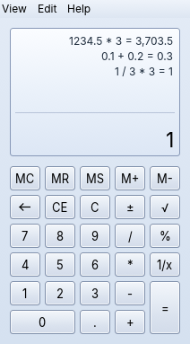
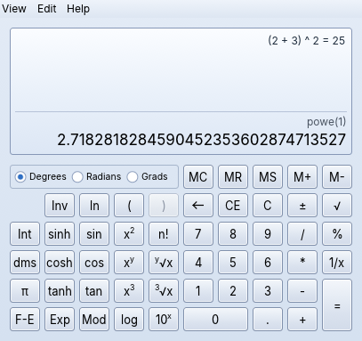
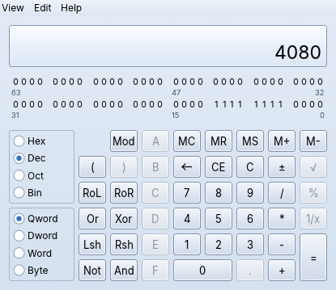
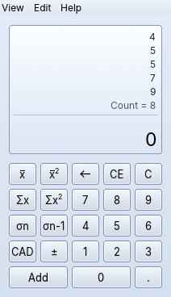
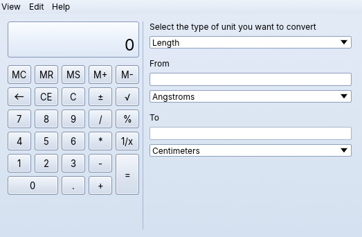
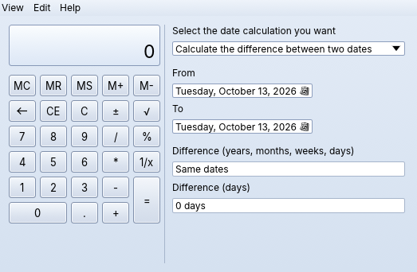
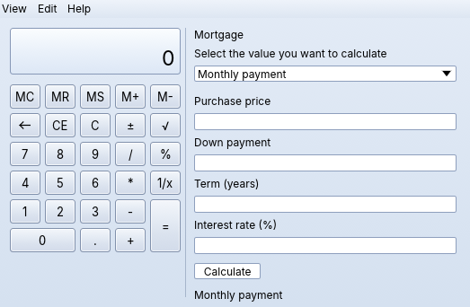
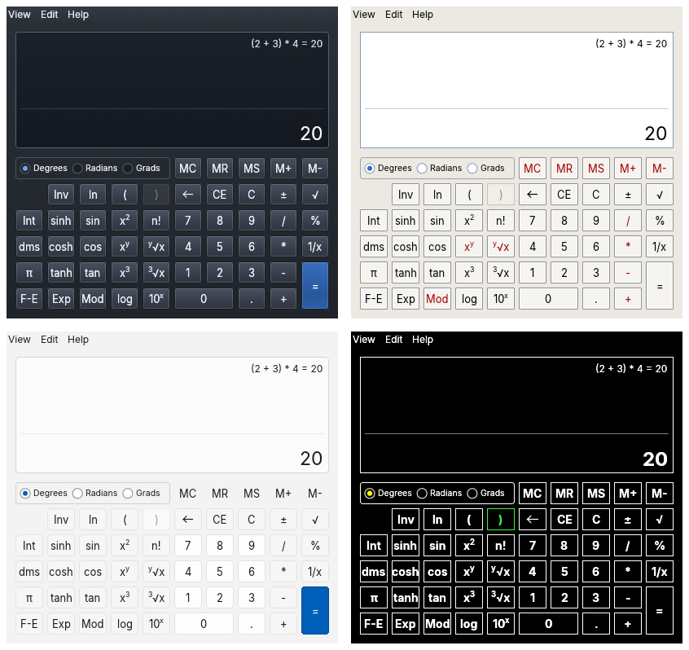

# SevenPlus Calculator

A desktop calculator written in Rust that works the way the Windows 7 Calculator did: the same four modes, the same keys and shortcuts, and the same answers. It runs on Windows, macOS and Linux, stays sharp at any display scale and can be themed with plain TOML files.

SevenPlus is an independent project inspired by the Windows 7 Calculator. It contains no Microsoft code, artwork or fonts.



## Features

### Standard mode

Operations run as you type, left to right: `2 + 3 * 4 =` gives 20, as on a pocket calculator.

- Memory keys `MC MR MS M+ M-`. An **M** in the display shows that memory is set.
- `%` works on the pending operation: `50 + 10 % =` gives 55.
- `√`, `1/x` and `±` act on the current number and show up in the expression line, e.g. `sqrt(9)`.
- Pressing `=` again repeats the last operation: `2 + 3 = =` gives 8.
- **History** (`Ctrl+H`) lists finished calculations. Click one to reuse its result.
- **Digit grouping** (View menu) shows `1,234,567.5`, using your system's separators.

Arithmetic is exact. `0.1 + 0.2` is `0.3` and `1 / 3 * 3` is `1`, because numbers are kept as exact fractions until a function like `sin` or `ln` needs an approximation. Results show 16 significant digits, rounded half to even.

### Scientific mode



- Normal operator precedence (`2 + 3 * 4 = 14`) and nested parentheses. The `(=n` indicator counts open brackets.
- Degrees, radians and grads. Exact angles give exact answers: `sin 30° = 0.5`, `tan 45° = 1`, `cos 90° = 0`.
- Trigonometric and hyperbolic functions and their inverses (`Inv`), `ln`, `log`, `eˣ`, `10ˣ`, `x²`, `x³`, `xʸ`, `ʸ√x`, `∛x`, `n!` (the gamma function for non-integers), `π`, `Mod`, `Int`/`Frac`, `dms`/`deg`, `Exp` and `F-E`.
- Results show 32 significant digits and are accurate to the last of them.

### Programmer mode



- Hex, Dec, Oct and Bin with Qword, Dword, Word and Byte word sizes. Values are two's-complement and wrap at the word size, just like integers in a program.
- `And`, `Or`, `Xor`, `Not`, `Lsh`, `Rsh`, `RoL`, `RoR`, `Mod`, and integer division that truncates toward zero.
- C syntax: the expression line shows `12 << 2 &`, `~x`, `%`, and you can type or paste `(1<<4)|3`. Buttons show the C signs too; Preferences can switch them back to `Lsh`, `And`, `Not`…
- Keys that don't fit the current base are disabled. The 64-bit panel shows every bit; click a bit to flip it.

### Statistics mode



Type a value and press `Add` (or `Insert`). The list shows the data and `Count = n`. Available results: mean `x̄`, mean of squares `x̄²`, `Σx`, `Σx²`, and the population and sample standard deviations `σn` and `σn-1`. To delete one value, select it and press `C`. `CAD` clears all values.

### Unit conversion, date calculation and worksheets

| Unit conversion (`Ctrl+U`) | Date calculation (`Ctrl+E`) | Worksheets |
|---|---|---|
|  |  |  |

These panels open beside the keypad, and the window grows to fit them:

- **Unit conversion** covers angle, area, energy, length, power, pressure, temperature, time, velocity, volume and weight/mass. Conversion factors are checked against NIST SP 811.
- **Date calculation** gives the difference between two dates in years, months, weeks and days, or adds or subtracts a span from a date.
- **Worksheets** are for mortgage, vehicle lease and fuel economy (mpg and L/100 km). Fill in all fields but one and the worksheet solves for it.

`Ctrl+F4` returns to the basic view.

### Themes



Five themes are built in: **Aero 7** (the default glass-blue look), **Classic**, **Light**, **Dark** and **High Contrast**. By default the calculator follows your system's light/dark setting, and it switches to High Contrast when the system's high-contrast mode is on. Switching themes takes effect immediately, without losing your calculation.

Every color, size and font is a token in a TOML file, and you can add your own themes without rebuilding anything. See [docs/themes.md](docs/themes.md).

### Everything else

- **Keyboard first.** Every key has a shortcut. Tab moves through the buttons in reading order, and Enter or Space presses the focused one. The full list is in [docs/keyboard.md](docs/keyboard.md).
- **Unit hint.** In Programmer mode a subdued `HEX · QWORD` (radix and word size) sits beside the result; in Scientific mode the angle unit (`DEG`, `RAD` or `GRAD`).
- **Copy and paste.** Double-click the result to copy it, or use `Ctrl+C`. Paste a number, or a simple expression like `(2+3)*4`, and it is typed for you.
- **Screen readers.** Every button has a name, and new results are announced (NVDA, VoiceOver and Orca, through AccessKit).
- **Sharp at any scale.** The calculator supports per-monitor DPI from 100% to 300%, including fractional scales. Move it to another monitor and it re-renders at that scale. Drag a corner to zoom the whole calculator, or use `Ctrl +`, `Ctrl -` and `Ctrl 0`.
- **Remembers where you left it.** Window position, mode, open panel, digit grouping and theme are restored at the next start.
- **Window frame.** Use the native OS frame, or a hand-drawn Aero glass frame (View ▸ Window frame).
- **Private.** The calculator works offline, with no network access and no telemetry.

## Install

Download the package for your system from the [releases page](https://github.com/taraskornuta/sevenplus/releases):

| System | Package |
|---|---|
| Windows 11 (x64, ARM64) | `.msi` installer (per-user or per-machine), or a portable `.zip` |
| macOS 12+ (Apple silicon and Intel) | `.dmg` |
| Debian 12+, Ubuntu 22.04+ (amd64, arm64) | `.deb` |
| Fedora 39+, RHEL 9, openSUSE Leap 15.5 (x86_64, aarch64) | `.rpm` |

On Linux it runs under both Wayland and X11. Each release also has a `SHA256SUMS` file.

## Settings and files

| What | Linux | macOS | Windows |
|---|---|---|---|
| Settings | `~/.config/sevenplus/settings.toml` | `~/Library/Application Support/sevenplus/settings.toml` | `%APPDATA%\sevenplus\config\settings.toml` |
| User themes | `~/.config/sevenplus/themes/` | `~/Library/Application Support/sevenplus/themes/` | `%APPDATA%\sevenplus\themes\` |
| Logs and crash reports | `~/.local/state/sevenplus/` | `~/Library/Logs/sevenplus/` | `%LOCALAPPDATA%\sevenplus\data\logs\` |

Most options are under **Edit ▸ Preferences** (`Ctrl+,`): theme, decimal and group separators, and copy format. The calculator saves settings itself. If the settings file is ever damaged, it is renamed to `settings.toml.bak` and the defaults are used. Set `RUST_LOG=info` for more detailed logs.

## Building

You need Rust. The pinned version in `rust-toolchain.toml` is installed automatically. On Linux, also install the X11/Wayland development headers (`libxkbcommon-dev`, `libwayland-dev`).

```sh
cargo run --release                        # build and start the calculator
cargo test --workspace                     # all tests, including the golden key sequences
cargo test --release -p calc-core --test perf
cargo clippy --workspace --all-targets -- -D warnings
cargo deny check                           # licenses, advisories, banned crates
cargo +nightly fuzz run keys               # fuzz the engine (needs cargo-fuzz)
```

The workspace has six crates:

| Crate | Purpose |
|---|---|
| `calc-core` | The calculator engine: a pure state machine (`press(key) -> DisplayState`) with exact rational arithmetic. It has no UI or OS dependencies. |
| `calc-format` | Display formatting: rounding, notation, digit grouping and locale separators. |
| `calc-theme` | Theme files: the TOML schema, inheritance and validation. |
| `calc-config` | Settings and per-OS folders, with atomic saves. |
| `calc-ui` | The egui user interface. |
| `calc-app` | The `sevenplus` binary: window, logging, crash reports and platform integration. |

`calc-core` checks its results against key-sequence files in `crates/calc-core/tests/golden/`; see the comments there to add more. To build installers (`.msi`, portable `.zip`, `.dmg`, `.deb`, `.rpm`) yourself, see [docs/packaging.md](docs/packaging.md). The GitHub Actions release workflow builds all of them when a `v*` tag is pushed. `docs/srs-deviations.md` lists where the implementation deliberately differs from the requirements specification.

## License

MIT. The bundled Inter font is under the SIL Open Font License 1.1. Third-party licenses are listed in Help ▸ Licenses.
